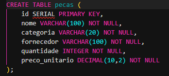
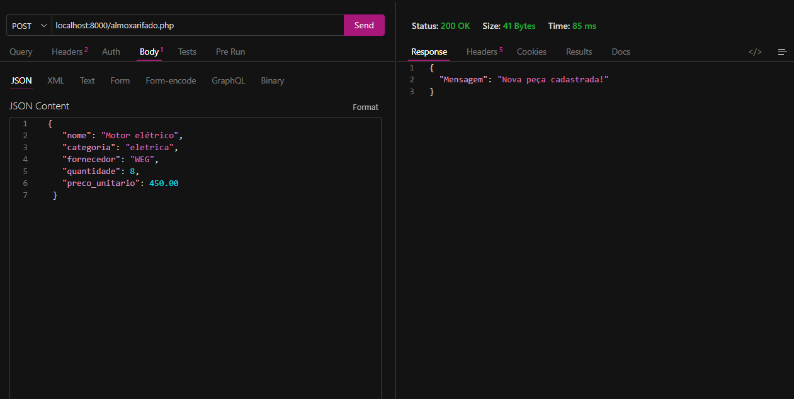
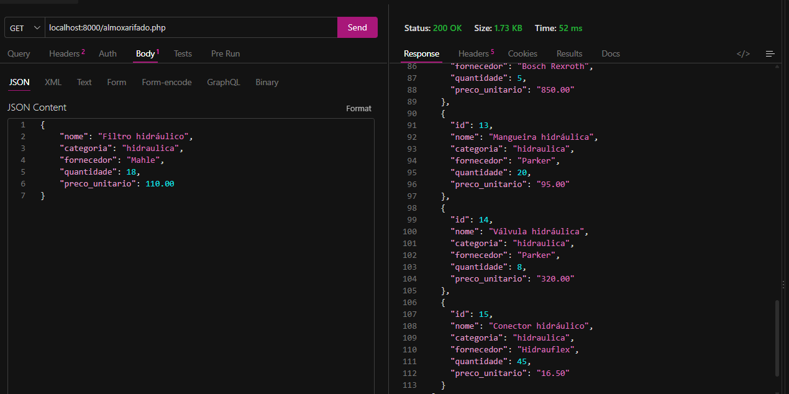
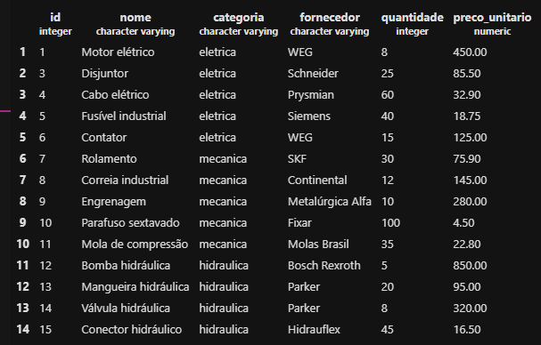
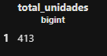
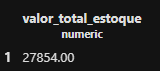
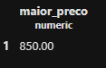
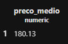
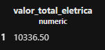

# API de Controle de Peças - Almoxarifado
**Julia Guerra Menoni - 1DEV46B T2**

### 1 - Criação do banco de dados

Primeiro, foi criado o banco de dados que será utilizado no projeto:

```sql
CREATE DATABASE almoxarifado;
```
Registro da execução:



Depois, foi realizada a conexão com o banco almoxarifado.

---
### 2 - Criação da tabela

Dentro do banco de dados, foi criada a tabela pecas:
```sql
CREATE TABLE pecas (
    id SERIAL PRIMARY KEY,
    nome VARCHAR(100) NOT NULL,
    categoria VARCHAR(20) NOT NULL,
    fornecedor VARCHAR(100) NOT NULL,
    quantidade INTEGER NOT NULL,
    preco_unitario DECIMAL(10,2) NOT NULL
);
```
> Campos da tabela
- id: identificador da peça, sendo chave primária e com  incremento automático.
- nome: nome da peça.
- categoria: categoria da peça.
- fornecedor: fornecedor da peça.
- quantidade: quantidade disponível no estoque.
- preco_unitario: preço de cada unidade da peça.

**As categorias utilizadas no projeto são:**

> eletrica;

> mecanica;

> hidraulica.

Registro da execução:


---

### 3 - API

A API foi desenvolvida em PHP, utilizando PDO para realizar a conexão com o PostgreSQL.

Os dados recebidos e enviados pela API são trabalhados no formato `JSON.`

> A API possui as quatro operações básicas de um CRUD:

POST -> Cadastrar uma peça;

GET ->	Listar as peças;

PUT -> Atualizar uma peça;

DELETE -> Excluir uma peça.

---

### 4- POST

O método POST é utilizado para cadastrar uma nova peça.

Exemplo de dados enviados:

```json
{
    "nome": "Motor elétrico",
    "categoria": "eletrica",
    "fornecedor": "WEG",
    "quantidade": 8,
    "preco_unitario": 450.00
}
```

Foram cadastradas 15 peças através do POST da própria API, e não diretamente pelo banco de dados.

* Os produtos possuem diferentes:

- nomes;
- fornecedores;
- categorias;
- quantidades;
- preços.

As três categorias `(eletrica, mecanica e hidraulica)` foram utilizadas nos cadastros.

Registro da execução:



---
### 5 - GET

O método GET é utilizado para listar todas as peças cadastradas no banco de dados.

A resposta é retornada em formato JSON.

Exemplo:

```json
    {
        "id": 1,
        "nome": "Motor elétrico",
        "categoria": "eletrica",
        "fornecedor": "WEG",
        "quantidade": 8,
        "preco_unitario": "450.00"
    }
```
Registro da execução:



*OBS: Nesta atividade, a implementação dos métodos PUT e DELETE não foi solicitada na prática. Por isso, o foco da implementação ficou nas operações e funcionalidades que foram exigidas na atividade.*

---

### 6 - Validações

Antes de realizar as operações, a API verifica se os dados obrigatórios foram informados.

Também são verificadas algumas regras:

* A categoria deve ser eletrica, mecanica ou hidraulica.
* A quantidade não pode ser negativa.
* O preço unitário deve ser maior que zero.
* Os campos obrigatórios devem ser preenchidos.

> Caso exista algum erro, a API retorna uma mensagem em JSON informando o problema.

---
### 7 - Consultas SQL

Depois de cadastrar as 15 peças através da API, foram realizadas algumas consultas SQL para analisar os dados do estoque.

Registro da execução:



**7.1 Total de unidades**

Para descobrir quantas unidades de peças existem no almoxarifado, foi utilizada a função SUM():

```sql
SELECT SUM(quantidade) AS total_unidades
FROM pecas;
```
Registro da execução:



---
**7.2 Valor total do estoque**

Para calcular o valor total do estoque, foi multiplicada a quantidade de cada peça pelo seu preço unitário e depois utilizada a função SUM():

```sql
SELECT SUM(quantidade * preco_unitario) AS valor_total_estoque
FROM pecas;
```
Registro da execução:



---
**7.3 Peça mais cara**

Para descobrir o maior preço unitário cadastrado, foi utilizada a função MAX():

```sql
SELECT MAX(preco_unitario) AS maior_preco
FROM pecas;
```
Registro da execução:



---
**7.4 Peça mais barata**

Para descobrir o menor preço unitário cadastrado, foi utilizada a função MIN():

```sql
SELECT MIN(preco_unitario) AS menor_preco
FROM pecas;
```
Registro da execução:


---
**7.5 Preço médio**

Para calcular o preço médio das peças, foi utilizada a função AVG().

A função ROUND() foi utilizada para deixar o resultado com duas casas decimais:

```sql
SELECT ROUND(AVG(preco_unitario), 2) AS preco_medio
FROM pecas;
```
Registro da execução:



---
**7.6 Valor total das peças elétricas**

Para calcular somente o valor das peças da categoria eletrica, foi utilizada a cláusula WHERE:

```sql
SELECT SUM(quantidade * preco_unitario) AS valor_total_eletrica
FROM pecas
WHERE categoria = 'eletrica';
```
Registro da execução:



---
### 8 - Funções utilizadas

Durante as consultas foram utilizadas as seguintes funções e comandos:

`SUM()` → realiza uma soma.

`MAX()` → encontra o maior valor.

`MIN()` → encontra o menor valor.

`AVG()` → calcula a média.

`ROUND()` → arredonda o resultado.

`AS` → cria um apelido para o resultado da consulta.

`WHERE` → filtra os registros de acordo com uma condição.

---

### 9 - Objetivo do projeto

O objetivo do projeto é desenvolver uma API para facilitar o controle das peças de reposição de um almoxarifado.

> Com a API, é possível cadastrar, consultar, atualizar e excluir peças, além de utilizar consultas SQL para obter informações sobre a quantidade e o valor dos produtos armazenados.